# DIY BACCAble — Full Plan, Build Steps and Firmware (v4.11)

**Mission:** build our own BACCAble from loose boards instead of buying the author's ready-made device, and make it **behave the same as the author's device in every way except the WS281x LED strip** (not built, not wired, left disabled).
**Build:** the **full BACCAble — three UCAN boards, C1 + C2 + BH**, one per CAN bus, exactly like the three chips on the author's PCB. This is **not** the two-board (C1 + BH) minimalist/test setup: every board, wire and step below is for three boards, and wherever a repo picture shows only one or two UCANs it is used only as a pad/label/mounting reference.
**Car:** 2022 Alfa Romeo Giulia Sprint Q4 · 2.0 petrol · MY22 cluster · SGW with an owned bypass cable (owner confirmed it passes all three buses).
**Owner's default choices:** gasoline parameters, **immobilizer OFF** and **Start&Stop disabler OFF** at first start (both still available: Start&Stop in the SETUP menu, immobilizer with the long button press).
**Status:** research, design and firmware build done; **nothing flashed or installed yet; the images are untested on hardware.**

Evidence tags: **[Repo]** read in this fork (manual v4.9, code, schematic, diagrams, build files) · **[FYSETC]** the UCAN maker's schematic and component drawing (github.com/FYSETC/UCAN `Hardware/`) · **[GiUCAN]** anegrin/GiUCAN, linked from the README · **[Author]** author's answer in upstream issue #34 · **[Infer]** my engineering inference — verify · **[Built]** compiled and checked in this session.

---

## 0. Read this first — the plan in plain words

### 0.1 What we are building
- **The BACCAble** plugs into the car's OBD port and talks to the car on its **three CAN buses**: C1, C2 and BH. A CAN bus is a two-wire network the car's computers use to talk to each other.
- **The author's device** has three small computers (STM32F072 chips) on one circuit board, one chip per bus.
- **We build the same thing from three FYSETC UCAN boards.** Each UCAN is a ready-made little board with the same chip family (STM32F072) and a CAN driver.
  - We name the boards **C1**, **C2** and **BH** after the bus each one sits on.
  - **C1 is the boss:** it shows the menu on the dashboard and tells the other two what to do over one shared wire.
- **Everything matches the author's device except the LED strip,** which we leave out (§1 lists every part side by side).

What makes our version work like the author's:

| Item | What we do | Where |
|---|---|---|
| Power | 12 V from OBD pin 16 → **1 A fuse** → small **12 V → 3.3 V converter** ("buck") → one plug per board | §4 |
| Serial wire | **one wire** joins C1, C2 and BH so they can talk | §2.3 |
| Sleep wires | **two wires** let C1 put C2 and BH to sleep when the car is parked, as the author's board does | §5 |
| Board changes | remove **two (sometimes three) tiny resistors** on each UCAN | §6 |
| Buttons | **one push button per board** for loading firmware | §2.3.4 |
| Firmware | the author's firmware with **one small switch** for the UCAN pins, already built for you in `firmware/ucan_prebuilt/` | §8 |

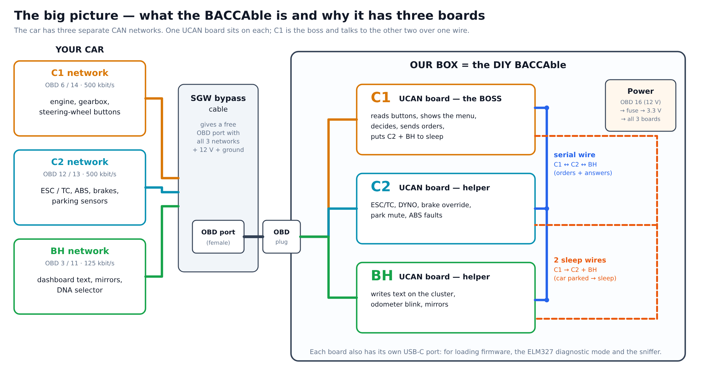

**How the three boards cooperate:** C1 hears the steering-wheel buttons, decides, and sends short orders over the serial wire. C2 and BH carry out the orders on their own networks. Two real examples from the code:

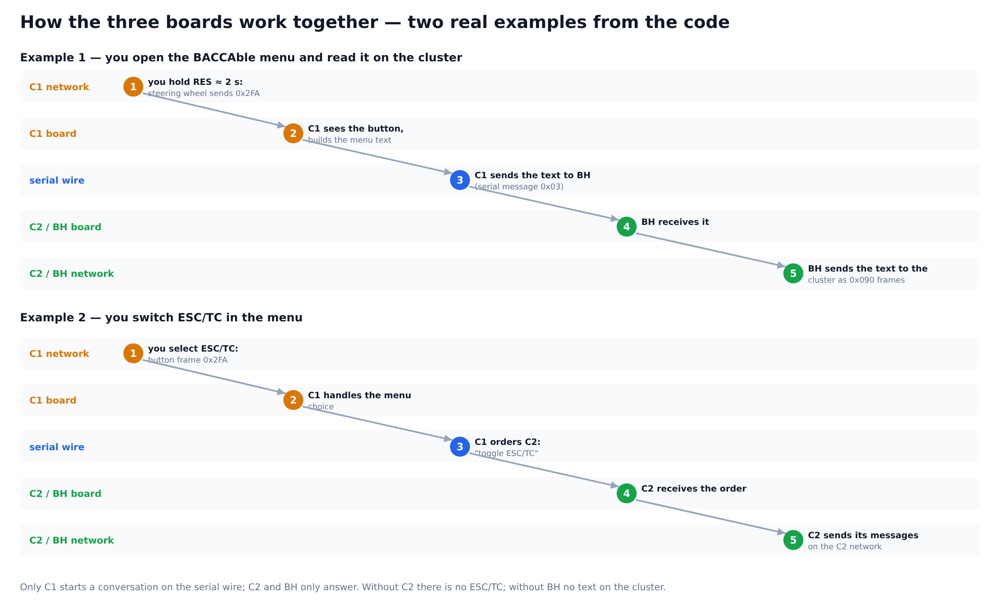

### 0.2 The golden rules (break one of these and something gets damaged or the car complains)
1. **12 V never touches a UCAN.** OBD pin 16 goes only to the fuse and the 3.3 V converter.
2. **Set the converter to 3.30 V before any board is connected,** and check it with the meter.
3. **USB or power plug, never both.** Before plugging USB into a board, unplug that board's power plug (§4.3).
4. **Remove the factory terminator (R1 + R2) on all three boards.** Through the finished harness each bus must measure about **60 Ω**; about 40 Ω means a terminator is still on (§6).
5. **Never swap CAN_H and CAN_L.** Mark every H wire at both ends. Swapped wires give warning lights.
6. **Load the firmware into C2 and BH before you fit the reset wire,** otherwise C1 keeps them asleep on the bench (§5.3).
7. **In the car, switch functions on one at a time.** Use DYNO, 4WD disable, ESC/TC and brake override only off public roads.

### 0.3 The whole job in 11 steps
| # | What you do | Details |
|---|---|---|
| 1 | **Check each board:** chip name, measure across the CAN terminal, find every pad with the meter's beep mode | H0, §2.2 |
| 2 | **Change each board:** take off R1 and R2 (and R4 if fitted), leave the jumper header empty | H1, §6 |
| 3 | **Solder** short wires or pins on the pads you need, and a boot button on each board | H2, §2.3.4 |
| 4 | **Make the OBD cable:** 9 pins used, one twisted pair plus ground to each board | H5, §2.3.2–2.3.3 |
| 5 | **Make the power cable:** fuse, converter set to 3.30 V, three small plugs | H6–H7, §4 |
| 6 | **Load the firmware** into C1, C2 and BH over USB (button held while plugging in) | S1–S2, §8 |
| 7 | **Join the boards:** serial wire, reset wire, standby wire; then the two bench tests | H3–H4, S3–S4, §5 |
| 8 | **Put everything in the box** with the USB ports, buttons and LED windows reachable | H9, §2.3.5 |
| 9 | **In the car, power off:** measure each bus (≈ 60 Ω), then connect | H8, H10 |
| 10 | **First start:** open the dashboard menu, check the settings | S5–S6 |
| 11 | **Switch functions on one by one,** then measure the parked current | S7–S8, H11 |

**Your toolkit for the whole job:**
- **Checking each board:** the decision chart in §7.
- **Measuring:** the meter card in §7.
- **Loading firmware:** the picture in §8.
- **Using the menu:** the picture in §9.
- **Reading the LEDs:** the picture in §9.
- **When something goes wrong:** the troubleshooting table in §9.1.

### 0.4 How this document is organised
- **§1–3:** what we copy from the author and how the boards are wired.
- **§4–6:** the three special topics: power, sleep, terminators.
- **§7 (hardware) and §9 (bring-up):** the step lists you follow with tools in hand.
- **§8:** the firmware and how to load it.
- **§10–11:** reference only. You don't need them to build.
- **§12–13:** risks, and what only the real boards can answer.

### 0.5 Words used in this plan
| Word | Meaning |
|---|---|
| **CAN bus, CAN_H / CAN_L** | the car's two-wire network; H and L are the two wires (always twisted together) |
| **C1, C2, BH** | the car's three CAN buses, and our three boards named after them: C1 on OBD 6/14, C2 on OBD 12/13 (both 500 kbit/s), BH on OBD 3/11 (125 kbit/s) |
| **SGW bypass** | the cable that lets a device reach the buses past the car's Secure Gateway; we plug into its OBD port |
| **UCAN** | the FYSETC USB-to-CAN board we use, three times (plus one spare) |
| **Pad** | a small round soldering point on the board, named by its printed label (CK, DO, RES, G, B0, 3V3…) |
| **Terminator** | a resistor across CAN_H–CAN_L at each end of a bus; the car already has them, so our boards must not add more |
| **Buck / converter** | a small module that turns 12 V into 3.3 V efficiently |
| **Ground star** | the one point where every ground wire meets (OBD pins 4 + 5) |
| **Firmware / image** | the program inside each board's chip; the `.bin`/`.elf` files are the images we load |
| **Flashing, DFU, boot button** | loading firmware over USB; holding the boot button while plugging USB in puts the chip in loading mode (DFU) |
| **Serial wire** | the shared wire the three chips talk over |
| **Reset wire / standby wire** | C1's two sleep wires: one holds C2/BH stopped, one puts their CAN drivers to sleep |
| **Transceiver (U1)** | the small 8-pin chip that drives the CAN wires |
| **Beep test** | the multimeter's continuity mode: it beeps when two points are connected |
| **Hn / Sn** | numbered hardware steps (§7) and bring-up steps (§9) |

---

## 1. What "the same as the author's device" means — parity table

**In short:** every part of the author's board has a matching part in our build. The only differences are where a wire is soldered, our own box, and one boot button per board instead of one shared button. The LED strip is left out on purpose.

The author's device (schematic `hardware/newBaccableDedicatedPcb/BACCABLE_SCHEMATIC.pdf`) is one PCB in an OBD plug with three STM32F072 chips. We rebuild it from three FYSETC UCAN boards.

| Part of the author's device | How the author does it [Repo] | How we do it | Same? |
|---|---|---|---|
| Three chips, one per CAN bus (C1, C2, BH) | U10/U20/U30, STM32F072, one transceiver each, CAN on PB8/PB9 | **Three UCAN boards** (STM32F072CB + CAN transceiver, CAN on PB8/PB9) | ✅ — **all three are required** |
| Firmware | `baccableC1/C2/BH` images from this repo | Same source; C1 built with our flags (§8), C2/BH unchanged | ✅ |
| Serial link between chips | one `Serial` net on PA14 of all three chips (USART2, 38400 baud, half-duplex, open-drain) | one wire joining the **CK pads** (PA14) of the three UCANs | ✅ |
| Sleep ("low consume") | C1 **PA4** holds C2/BH in reset; C1 **PA5** puts the C2/BH transceivers in standby; C1 keeps listening and wakes them on CAN activity | **Reset line:** C1 **DO pad (PA13)** → **RES pads** of C2 and BH (flag `UCAN_LOW_CONSUME_PINS`). **Standby line:** C1 **PA5** (unchanged author pin, fine wire on chip pin 15) → **pin 8 (S/RS) of the CAN transceiver** on C2 and BH (§5.2) | ✅ identical behaviour (same firmware logic, same two lines) |
| Power | 12 V from OBD pin 16 → fuse F1 → buck U1 (4.5–35 V in) → **3.3 V straight to the chips**; USB 5 V can also feed the buck input through diode D2; ≈ 15 mA asleep, < 30 mA running | **Chosen — Option B:** pin 16 → fuse 1 A → **12→3.3 V buck → P3 3V3 + G pads** of the three UCANs (§4) | ✅ identical topology; rule: unplug a board's 3V3 plug before plugging USB into it (no D2 diode on a UCAN) |
| Programming button | one button pulling BOOT0 of all three chips | one push button **B0 ↔ 3V3** per UCAN | ✅ |
| USB port per chip (flash, sniffer, ELM327, pen drive) | J10/J20/J30 USB-C | each UCAN's own USB-C | ✅ |
| Status LEDs | green power + red (PA0) + white/blue/yellow (PA1) per chip | each UCAN's **LD3 "3V3"** (power), **LD1 "RX"** (PA0 = red) and **LD2 "TX"** (PA1 = blue), seen through windows in the box (§2.3.5; `UCAN_BOARD_LED_INVERSION` is the build default) | ✅ |
| No CAN termination | none on the PCB | each UCAN's fixed 118 Ω terminator (**R1 + R2, 2 × 59 Ω**) **removed**, termination header JP1 left **open** (§6) | ✅ |
| OBD plug through the SGW bypass | the PCB is the OBD plug | OBD male breakout harness into the bypass port | ✅ |
| LED-strip output (PA11) | OBD pin 8 (on C1, PA11 is also the USB D− line of J10: shared net) | **not built** (mission) | ➖ excluded |
| Aftermarket exhaust-valve remote output | C1 **PA8** → R15 4.64 kΩ → NPN **Q10** → R16 1 kΩ → `CMD_1` = **OBD pin 1** (the firmware also pulses **PA7** for "close", but the schematic draws no transistor on PA7) | optional: copy Q10 on a fine wire to C1 chip pin 29 (and, for "close", a second one on pin 17) (§10) — only if you fit aftermarket valves with a radio remote | ⚪ optional |
| Pedal-booster serial (C1 USART1 on PB6) | cable to "schizzaForte" | optional fine-wire on C1 pin 42 (§10); the manual says the pedal booster is "under development, do not activate" | ⚪ optional |
| STS inputs, C2/BH output transistors, GSM footprint | STS_1–3 on PA6 of each chip; Q20 (C2 PA8 → `CMD_2`, OBD 15) and Q30 (BH PA8 → `CMD_3`, OBD 2); GSM module on C2 | **not used by the firmware** (no code reads PA6; only C1's code drives PA7/PA8; no GSM code) | — nothing to copy |

**What is not the same (honestly):** loose boards in our own box instead of the moulded OBD plug; the reset line leaves from PA13 instead of PA4 (same signal, a pad instead of a chip pin); one boot button per board instead of one shared button; each UCAN keeps its own power LED and regulator (bypassed by the 3.3 V rail).

**The author's device we are copying** (manual §1.11): one box, three USB-C ports (one per chip: BH, C2, C1 from left to right) and one programming button. The author's video walkthrough of the PCB (screenshots and transcript supplied by the owner) describes the same design:
- three sections on one 3.3 V supply, with USB power entering the same regulator input;
- one boot button that puts all three chips in boot mode;
- green power LED, a red LED per chip, and white / blue / yellow for C1 / C2 / BH;
- C1 waking the other two through reset and putting their transceivers in low power;
- CMD/STS pins, the LED-strip pin and a GSM header for future use.

Nothing in it differs from the schematic in the repo.

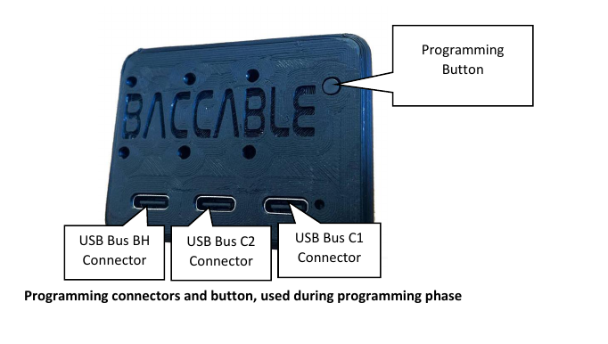

*Source: `manuals/Baccable_manual_EN.pdf`, page 16.*

---

## 2. Architecture and wiring

### 2.1 Buses (manual §1.2, DLC pinout image)
| Board | Role | OBD H / L | Bus speed | Main functions |
|---|---|---|---|---|
| **C1** | master/gateway | **6 / 14** | 500 kbit/s | dashboard menu and settings, Start&Stop, immobilizer, shift, 4WD disabler, ACC/HAS pads, windows, seat-belt, read faults (BODY/ECM), ELM327, sniffer, sleep control |
| **C2** | slave | **12 / 13** | 500 kbit/s | ESC/TC, DYNO, front-brake override, front park mute, ABS faults |
| **BH** | slave | **3 / 11** | 125 kbit/s | text on the cluster, odometer blink, park mirror, DNA Memory (not usable on the owner's car) |

GND = OBD 4 and 5, +12 V = OBD 16. [Repo]

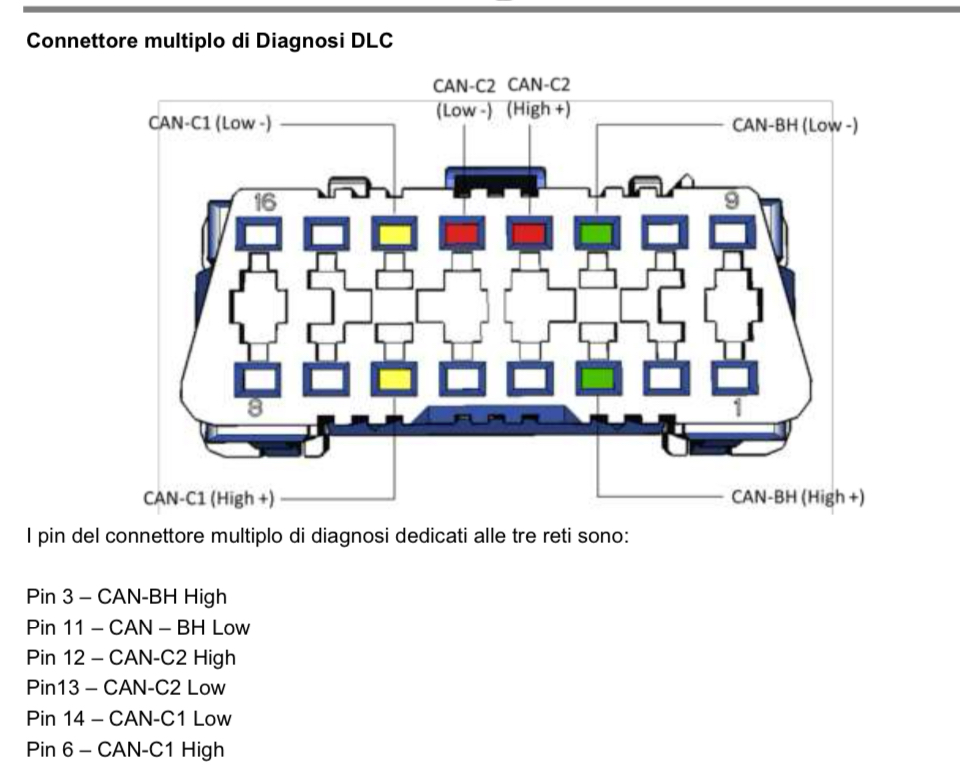

The picture is drawn from the car side (pins 1–8 bottom row, 9–16 top row). The drawings in the repo, and ours in §2.3.2, are not all turned the same way. **Always go by the pin numbers moulded into your plug.**

The author's own OBD plug pinout (what his PCB uses on each pin — we only use 3, 4, 5, 6, 11, 12, 13, 14, 16):


*Source: `hardware/newBaccableDedicatedPcb/pinout.png` (also manual page 5). CMD1–3, STS1–3 and LED CTRL are the author's extra I/O (§10); not used here.*

### 2.2 The UCAN board, part by part (board maker's schematic)
**Our board is the one the author uses:** the FYSETC UCAN sold at https://www.fysetc.com/products/fysetc-ucan-board, documented in FYSETC's open-source repository https://github.com/FYSETC/UCAN. That repository holds only:
- the README, with a top-view render;
- `Hardware/UCAN V1.0 SCH.pdf` and `Hardware/UCAN V1.0 Component Position.pdf`;
- a STEP model.

What its README says, and how it fits the build:

| FYSETC README says | Meaning for us |
|---|---|
| STM32F072, candleLight firmware | same chip family the BACCAble README asks for |
| "Compatible with candleLight V1 hardware pin assignment" | LEDs on PA0/PA1 and CAN on PB8/PB9, as the BACCAble firmware expects; the BACCAble README lists candleLight among the compatible boards |
| "3-pin screw plug terminal: CANH, CANL, GND" | the order of the README's text only: the schematic gives P1 pin 1 = CAN_L, pin 2 = CAN_H, pin 3 = GND, and the silkscreen in the repo's photo reads CAN_L · CAN_H · GND. **Go by the print on your board** |
| "Headers to enter bootloader … and SWD interface" | the P2 row (B0, 3V3, CK = SWCLK, DO = SWDIO, RES, G) |
| "Headers to CAN interface before transceiver" | the P3 row (RX, TX, G, 3V3): not used |
| "Headers to enable/disable termination, **On-board termination resistors (2 x 59R) are used by default**" | **every UCAN arrives terminated**, which is what §6 removes |

The board details below come from FYSETC's schematic and component-position drawing. They agree with the repo's pictures and the firmware's pin use. [FYSETC][Repo]

| Ref | What it is | What we do with it |
|---|---|---|
| **U3** | STM32F072**CB**T6 (128 KB), the chip | runs C1 / C2 / BH firmware (the 8 MHz crystal X1 is unused: the firmware runs on the internal 48 MHz clock) |
| **U1** | **SN65HVD230** CAN transceiver (the bus driver), powered from 3.3 V (R22 0 Ω). **Pin 8 (RS)** is the net `CAN_S` = chip **pin 2 (PC13)**, with **R4 10 kΩ to 3.3 V** and **R18 10 kΩ to GND** next to it. The author has only pull-downs: **R17 10 kΩ** on C1's RS pin, and **one R27 10 kΩ** on the shared `CanLowConsumeCmd` net of C2/BH | **remove R4** if it is fitted (H0/H1), leaving R18 = the author's 10 kΩ pull-down. **Check the transceiver type first (§4.6):** FYSETC's schematic also allows a 5 V SIT1051T/3 or MP2542 build |
| **P1** | green 3-way screw terminal: **1 = CAN_L, 2 = CAN_H, 3 = GND** | the car bus |
| **R1, R2** | **59 Ω + 59 Ω in series across CAN_H–CAN_L** (split terminator, ≈ 118 Ω; the middle goes to C4 4.7 nF to GND). In the schematic they are always connected, and FYSETC says they are on by default | **remove both** on C1, C2 and BH when H0 reads ≈ 118 Ω (§6) |
| **JP1 + R3** | 2-pin header + 120 Ω: adds a **second** terminator when a jumper is fitted | keep **open** |
| TVS1, C5, C6 | CAN-line surge protection and filter | keep |
| **P2** | 6-pad row, printed in this order from the USB end: **1 CK** = SWCLK = **PA14** (chip pin 37, R14 **4.7 kΩ pull-up**) · **2 DO** = SWDIO = **PA13** (chip pin 34) · **3 RES** = NRST (chip pin 7, R9 **10 kΩ pull-up** + C10 100 nF) · **4 G** · **5 B0** = BOOT0 (chip pin 44, R8 **10 kΩ pull-down**) · **6 3V3** | serial, reset, boot button |
| **P3** | 4-pad row, printed **RX · TX · G · 3V3** from the USB end (RX = CAN_RX PB8, TX = CAN_TX PB9; the schematic numbers them 3V3 = 1, TX = 2, RX = 3, GND = 4) | **G and 3V3 = our 3.3 V power input** (two adjacent pads, a 2-pin plug fits); RX and TX unused |
| **LD1 "RX"** | LED on **PA0** (chip pin 10) through R6 2.2 kΩ = the firmware's **"red"** LED | status (§2.3.5) |
| **LD2 "TX"** | LED on **PA1** (chip pin 11) through R13 2.2 kΩ = the firmware's **"blue"** LED | status (§2.3.5) |
| **LD3 "3V3"** | power LED on the 3.3 V rail through R19 2.2 kΩ | power indicator (= the author's green D1) |
| U2 | AP2112K-3.3 regulator, USB 5 V → 3.3 V | bypassed: our buck feeds its output side (§4) |
| USB1 | USB-C (data to PA11/PA12, 5.1 kΩ CC resistors on board) | left free for flashing, ELM327, sniffer |

The C1 / C2 / BH firmware never touches **PC13** (no GPIOC code in the fork), so on C2 and BH the transceiver's pin 8 is free for the author's standby line. [Repo]

**Identify every pad with the meter before soldering** (board unpowered, continuity/beep mode). Don't rely only on silkscreen read from photos. On the LQFP48 chip, pin 1 is at the dot; count anticlockwise, 12 pins per side.

**Where the dot is:** in FYSETC's README render (USB on the left, terminal on the right), the dot is in the chip's **bottom-right** corner. [FYSETC][Infer]
- Pin 1 is the lowest pin of the chip's right-hand side.
- Pins 1–12 run up the right side.
- Pins 13–24 run right to left along the top side.
- Pins 25–36 run down the left side.
- Pins 37–48 run left to right along the bottom side.

So **PA5 = pin 15 is the 3rd pin from the right on the top side** (PA4 = pin 14 is the 2nd). **Confirm the orientation before soldering:** pin 37 (bottom side, leftmost) must beep to **CK**, and pin 34 (left side, 3rd from the bottom) to **DO**. On U1 (8 pins), pin 1 is at the dot or chamfer; pin 8 is beside pin 1 on the other row, on the side facing the green terminal, closest to R4/R18.

| Pad | Must beep to |
|---|---|
| CK | chip pin 37 |
| DO | chip pin 34 |
| RES | chip pin 7 |
| B0 | chip pin 44 |
| G (P2 and P3) | P1 terminal 3 (GND) |
| 3V3 (P2 and P3) | chip pin 24 or 48 (VDD) |
| U1 pin 8 | chip pin 2 (PC13), and one end of R18 |

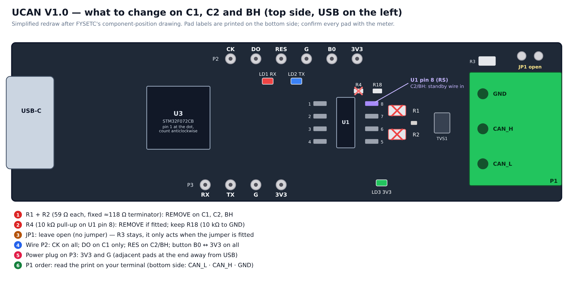

*Drawn for this plan after FYSETC's component-position drawing: parts to remove (R1, R2, R4 if fitted), JP1 open, transceiver pin numbers, LED and pad positions. Confirm with the meter.*

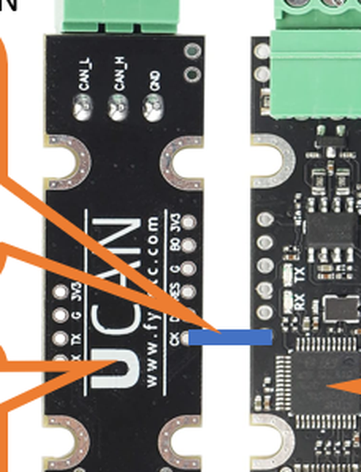

*Zoom of the author's diagram below: left board seen from the bottom (CAN_L · CAN_H · GND terminal; the P2 row CK · DO · RES · G · B0 · 3V3 with the blue serial wire on CK; the P3 row); right board seen from the top (RX/TX LEDs, chip, termination header JP1 next to the green terminal). The left column reads RX · TX · G · 3V3 from the USB end (the "R" is cut off).*


*Source: `hardware/system_interconnection/ShowParamsOnDashboardConnections.png`. **Use it only as a pad reference** (where CK, DO, RES, G, B0, 3V3 are and how the serial wire lands on CK). The picture is the author's reduced test drawing with just C1 and BH on USB 5 V. **It is not our build.** Our build is the three-board drawing in §2.3: C2 joins the same CK wire (author, issue #34), plus the reset wire, the standby wire and the 3.3 V rail of §4.*

### 2.3 Complete wiring — three boards, every wire (the author's PCB rebuilt)

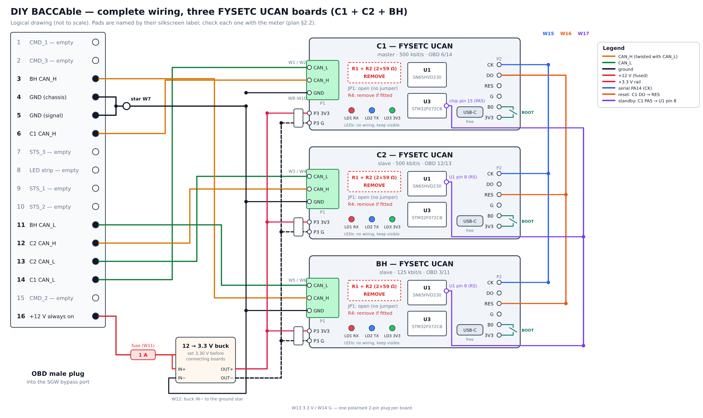

*Drawn for this plan (`docs/images/src/make_diagrams.py`): every wire W1–W17 of §2.3.3 and the boot buttons; logical, not to scale.*

#### 2.3.1 Layout
Left to right like the author's three USB-C ports (BH, C2, C1). Each signal wire lands on C2's pad and carries on to BH.
```
   ┌───────────┐      ┌───────────┐      ┌───────────┐
   │ BH        │      │ C2        │      │ C1 master │   ← three UCANs, all required
   │ 125 kbit  │      │ 500 kbit  │      │ 500 kbit  │
   │ OBD 3/11  │      │ OBD 12/13 │      │ OBD 6/14  │
   │ CK     ●──┼──────┼─●CK ──────┼──────┼─●CK       │   W15 serial  (one wire, three pads)
   │ RES    ●──┼──────┼─●RES ─────┼──────┼─●DO       │   W16 reset   (one wire from C1 DO)
   │ xcvr 8 ●──┼──────┼─●xcvr 8 ──┼──────┼─●pin 15   │   W17 standby (one wire from C1 PA5)
   │ P3 3V3+G● │      │ P3 3V3+G● │      │ P3 3V3+G● │   W13/W14 power plug
   │ B0─[btn]─3V3     │ B0─[btn]─3V3     │ B0─[btn]─3V3   boot button
   │ LD1 LD2 LD3      │ LD1 LD2 LD3      │ LD1 LD2 LD3    visible through the lid
   └──USB-C────┘      └──USB-C────┘      └──USB-C────┘
     P1 ↓               P1 ↓               P1 ↓            CAN_L · CAN_H · GND to the OBD plug
            │                  │                  │
            └──────────────────┴──────────────────┴── 2-pin plugs (3V3 + G) from the 3.3 V buck (§4)
```

#### 2.3.2 OBD male plug — all 16 pins

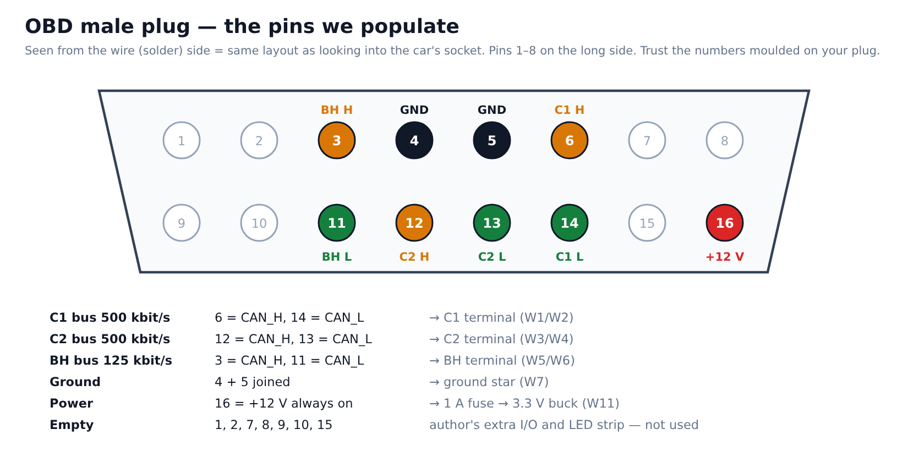

Pin names are from the author's plug (`pinout.png`, schematic sheet 1 J1). Only populate the pins marked as wired; leave the others empty, or cut and insulate them on a pre-wired plug.

| OBD pin | Author's signal | Our build |
|---|---|---|
| 1 | CMD_1 (exhaust remote, §10) | **empty** |
| 2 | CMD_3 | **empty** |
| **3** | CAN BH H | **W5 → BH P1-2 (CAN_H)** |
| **4** | GND (chassis) | **W7 → ground star** |
| **5** | GND (signal) | **W7 → ground star** (4 and 5 joined, as on the author's PCB) |
| **6** | CAN C1 H | **W1 → C1 P1-2 (CAN_H)** |
| 7 | STS_3 (unused input) | **empty** |
| 8 | Led_Control_Pin (LED strip) | **empty** (LED strip excluded) |
| 9 | STS_1 | **empty** |
| 10 | STS_2 | **empty** |
| **11** | CAN BH L | **W6 → BH P1-1 (CAN_L)** |
| **12** | CAN C2 H | **W3 → C2 P1-2 (CAN_H)** |
| **13** | CAN C2 L | **W4 → C2 P1-1 (CAN_L)** |
| **14** | CAN C1 L | **W2 → C1 P1-1 (CAN_L)** |
| 15 | CMD_2 | **empty** |
| **16** | +12 V (always on) | **W11 → fuse 1 A → buck IN+** |

#### 2.3.3 Wire list
| # | From | To | Wire | Notes |
|---|---|---|---|---|
| W1 / W2 | OBD 6 / OBD 14 | C1 P1-2 CAN_H / C1 P1-1 CAN_L | 22–24 AWG, **twisted pair** | mark the H wire at both ends |
| W3 / W4 | OBD 12 / OBD 13 | C2 P1-2 / C2 P1-1 | 22–24 AWG, twisted pair | |
| W5 / W6 | OBD 3 / OBD 11 | BH P1-2 / BH P1-1 | 22–24 AWG, twisted pair | |
| W7 | OBD 4 + OBD 5 | ground star (one crimp or solder point) | 22 AWG | the single ground point of the build |
| W8 / W9 / W10 | ground star | C1 / C2 / BH **P1-3 (GND)** | 22–24 AWG, twisted in with that board's pair | CAN reference; it is the board's only ground when it runs from USB with its 3V3 plug removed |
| W11 | OBD 16 | **inline fuse 1 A** (at the plug) → buck IN+ | 22 AWG | |
| W12 | ground star | buck IN− | 22 AWG | |
| W13 | buck OUT+ (3.3 V) | three 2-pin plugs, pin 1 → **P3 3V3** of C1, C2, BH | 22–24 AWG | set the buck to 3.30 V **before** connecting (§4.2) |
| W14 | buck OUT− | three 2-pin plugs, pin 2 → **P3 G** of C1, C2, BH | 22–24 AWG | polarised plugs; never reversible |
| W15 | C1 **CK** | C2 **CK** → BH **CK** | 26 AWG | the author's `Serial` net (PA14) |
| W16 | C1 **DO** | C2 **RES** → BH **RES** | 26 AWG | the author's `ChipLowConsumeCmd` (fit after S2, §5.3) |
| W17 | C1 chip **pin 15 (PA5)** | **U1 pin 8** of C2 → U1 pin 8 of BH | 30 AWG wire-wrap / enamelled | the author's `CanLowConsumeCmd`; glue the wire down near the chip (strain relief) |
| W18 / W19 / W20 | C1 / C2 / BH **B0** | a push button to the same board's **P2 3V3** | 26 AWG | boot button (§2.3.4) |

**Nothing else is connected.** These stay unconnected:
- C1 RES, C1's own U1 pin 8.
- C2/BH DO, all P2 G pads (ground already arrives through P3 G).
- P3 RX/TX on every board.
- JP1 on every board (open).
- The three USB-C ports (free).
- OBD pins 1, 2, 7, 8, 9, 10, 15.

**Per board, pad by pad:**
| Pad | C1 | C2 | BH |
|---|---|---|---|
| P1-1 CAN_L | OBD 14 | OBD 13 | OBD 11 |
| P1-2 CAN_H | OBD 6 | OBD 12 | OBD 3 |
| P1-3 GND | ground star | ground star | ground star |
| P2 CK | W15 | W15 | W15 |
| P2 DO | **W16 out** | — | — |
| P2 RES | — | **W16 in** | **W16 in** |
| P2 B0 / P2 3V3 | button | button | button |
| P3 3V3 / P3 G | 3.3 V plug | 3.3 V plug | 3.3 V plug |
| chip pin 15 (PA5) | **W17 out** | — | — |
| U1 pin 8 | — | **W17 in** | **W17 in** |
| R1 + R2 (59 Ω ×2) | **removed** | **removed** | **removed** |
| R4 (10 kΩ RS pull-up), if fitted | **removed** | **removed** | **removed** |
| JP1 | open | open | open |

**No extra resistors are needed anywhere.** The pull-ups and pull-downs on the author's PCB are already on each UCAN:
- **Serial line:** R14 4.7 kΩ pull-up on every board; three in parallel ≈ 1.6 kΩ, fine for the 38400-baud open-drain line.
- **Reset line:** R9 10 kΩ + 100 nF on each slave's RES.
- **Standby line:** R18 10 kΩ pull-down on each slave's transceiver pin 8 (with R4 removed). The author has one 10 kΩ (R27) on the shared net; ours is two in parallel (≈ 5 kΩ), which only adds ≈ 0.3 mA on PA5 while asleep — same behaviour.
- **Boot button:** R8 10 kΩ BOOT0 pull-down, the same as the author's R4.

There are no series resistors on the serial, reset or standby wires, as on the author's PCB. [Repo][FYSETC]

**Lengths** [Infer]:
- **OBD plug to each P1:** ≤ 30 cm. This is an unterminated stub on a 500 kbit/s bus, and the bypass cable already adds its own length.
- **W15–W17:** ≤ 30 cm.

#### 2.3.4 Boot buttons (the author's S1, one per board)
- **What to fit:** one normally-open momentary button per board, between **B0** and **3V3** on the P2 row. The board's own R8 10 kΩ keeps BOOT0 low when it is not pressed, as the author's R4 does.
- **When it acts:** only at power-up. Hold it while plugging the data USB-C in (§8), and release once the board shows up as `0483:df11` (the author's manual says "when the green LED is lit").
- **Mounting:** reachable from outside the box, each labelled BH / C2 / C1 under its USB-C opening.
- **Why one per board instead of one shared button:** during flashing the board runs from the PC's USB with its 3V3 plug removed, so it is not on the common 3.3 V rail.
- **Don't press it** while connecting the OBD plug (manual §1.3).

#### 2.3.5 LEDs — nothing to wire, make them visible
Each UCAN already has the author's three status lights:

| UCAN LED | Firmware name | Author's PCB | Meaning (§11.3) |
|---|---|---|---|
| **LD3 "3V3"** | — | green D1 (power) | lit = board powered |
| **LD1 "RX"** (PA0) | "red" | red D11 | attention / errors; steady blinking = start-up fault |
| **LD2 "TX"** (PA1) | "blue" | white (C1) / blue (C2) / yellow (BH) | short pulses = activity; 2 blinks at power-up = immobilizer active (not with our defaults) |

**Why the LEDs are dim:** the firmware drives PA0/PA1 as open-drain with only the chip's weak internal pull-up (`onboardLed.c`: `GPIO_MODE_OUTPUT_OD`, `GPIO_PULLUP`; "on" = released with `UCAN_BOARD_LED_INVERSION`). So the LEDs glow dimly, as on the author's device; the manual §1.5 says the internal blue LED can only be seen with the eye aligned to it.

**Don't add external LEDs in parallel:** they would share that tiny current and both would be dimmer.

**Do this instead:** a clear lid, or a 3 mm hole / light pipe over **LD1, LD2 and LD3 of each board** (nine windows, grouped per board and labelled BH / C2 / C1). [Repo][FYSETC]

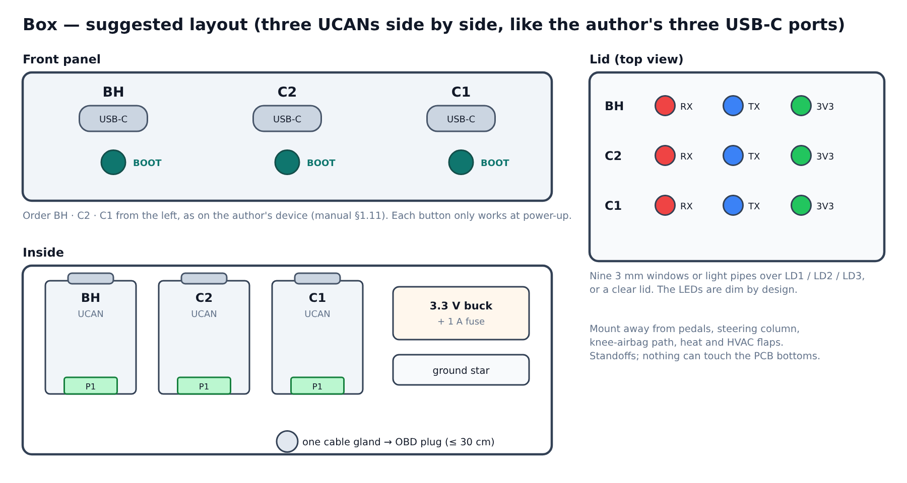

#### 2.3.6 Wiring rules
- **Power all three boards together.** Don't run the build with one board's 3V3 plug removed and no USB in it: the running boards' pull-ups on CK/RES and the standby wire would feed it weakly through its pins. During a USB session the board runs from the PC, which is fine (§4.3).
- **Two ground paths per board** (P3 G through the power plug, and P1-3 through the CAN cable) are intended. They are the same net on the board and meet only at the ground star.
- **Never 12 V on any UCAN pad.** OBD 16 goes only to the fuse and buck.
- **Mark** every CAN_H wire and every board (C1 / C2 / BH) at both ends of every cable.

#### 2.3.7 Netlist summary
```
                         OBD male plug (into the SGW bypass port)
  pin 6 ─ C1.CAN_H    pin 12 ─ C2.CAN_H    pin 3  ─ BH.CAN_H
  pin 14 ─ C1.CAN_L   pin 13 ─ C2.CAN_L    pin 11 ─ BH.CAN_L
  pins 4+5 ─ ground star ─ C1/C2/BH P1-3 GND, buck IN−/OUT−, P3 G pads (via the plugs)
  pin 16 (+12 V) ─ fuse 1 A ─ 12→3.3 V buck ─ 2-pin plugs ─ P3 3V3 of C1, C2, BH

  Serial (author's "Serial" net):     C1.CK ──── C2.CK ──── BH.CK                       (W15)
  Sleep reset (author's PA4 line):    C1.DO ──┬─ C2.RES
                                              └─ BH.RES                                 (W16)
  Sleep standby (author's PA5 line):  C1 chip pin 15 (PA5) ──┬─ C2 U1 pin 8 (RS)
                                                             └─ BH U1 pin 8 (RS)        (W17)
  Boot buttons:                       B0 ─[button]─ 3V3 on each board                   (W18–W20)
  Removed:                            R1 + R2 (59 Ω ×2) and, if fitted, R4 (10 kΩ) on C1, C2, BH; JP1 open
```

---

## 3. Boards to use

- **FYSETC UCAN V1.0 ×3 + 1 spare.** It is one of the four boards the README lists as compatible ("important that the chip is an STM32F072"); the author ships cases for it (`hardware/box/dual_fysect_ucan`, `single_fysect_ucan`) and the firmware's LED default is for it. [Repo]
- **All three need 128 KB of flash**: C1 is 79,004 bytes [Built]; C2 and BH keep a 64 KB FAT area and their settings in flash up to `0x0801FFFF` (§11.4). The author's own chips are labelled C8T6 (64 KB on paper, see the datasheet in `hardware/canable/`) yet run these images with a 96 KB code region and settings at `0x0801F800`, so they behave as 128 KB; the UCAN's CB chip is 128 KB on paper. **Read the flash size of every board in STM32CubeProgrammer before flashing.** [Repo][GiUCAN]
- Other boards the README lists (MKS CANable, DykbRadio Nano, candleLight) work only with a 128 KB STM32F072; CANable-type boards need `-DDISABLE_UCAN_BOARD_LED_INVERSION` (their LEDs are active-low on PA0/PA1, see the MKS schematic in the repo). Not needed for this build. [Repo]

The author's own 3D cases for the UCAN. **Mounting reference only:** they hold one or two boards (the author's partial-test setups); our box must hold **all three UCANs** side by side plus the buck and the fuse (H9). Look at them only for how a board sits, where the USB-C opening goes and the 2-pin header next to the green terminal:

| Two-UCAN case (`hardware/box/dual_fysect_ucan/preview.png`) — reference only | One-UCAN case (`hardware/box/single_fysect_ucan/preview.png`) — reference only |
|---|---|
|  |  |

---

## 4. Power — chosen design: Option B, identical to the author (always-on 12 V → 3.3 V rail)

### 4.1 The chain
**The author confirmed this to the owner directly:** asked whether the USB +5 V connection is always needed when the cable is plugged into the OBD port, even without the immobilizer, he answered *"Con la mia scheda la alimentazione viene dalla obd"* ("with my board the power comes from the OBD"). No separate USB 5 V feed is needed. [Author]

Only the car's OBD port is used, through your SGW bypass cable: **pin 16 = +12 V** (the pin the author's device is powered from, manual §1.2; the manual's immobilizer section relies on it being live with the car off) and **pins 4/5 = ground**. No other wire in the car is tapped.
```
OBD pin 16 (+12 V) ─ inline fuse 1 A ─ 12→3.3 V buck IN+ ; OUT 3.3 V ─┬─ 2-pin plug ─ C1: P3 3V3 + P3 G
OBD pins 4/5 (GND) ─ ground star ───── buck IN− / OUT−               ├─ 2-pin plug ─ C2: P3 3V3 + P3 G
                                                                      └─ 2-pin plug ─ BH: P3 3V3 + P3 G
(no USB-C power leads — the USB-C ports stay free for flashing, ELM327 and the sniffer)
```

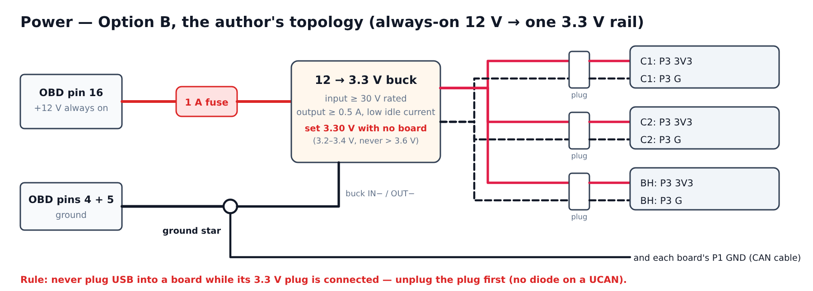

This is the author's topology: his PCB has fuse **F1** → buck **U1** making **3.3 V directly** (feedback divider 69.8 kΩ / 22.1 kΩ ≈ 3.3 V) for all three chips and transceivers. Feeding the UCANs on their **3V3 pads** bypasses each UCAN's own 5 V → 3.3 V regulator (U2, AP2112K), exactly like the author's single 3.3 V rail, and gives the lowest parked current. [Repo: schematic sheet 1, manual §1.2/§1.10][Infer]

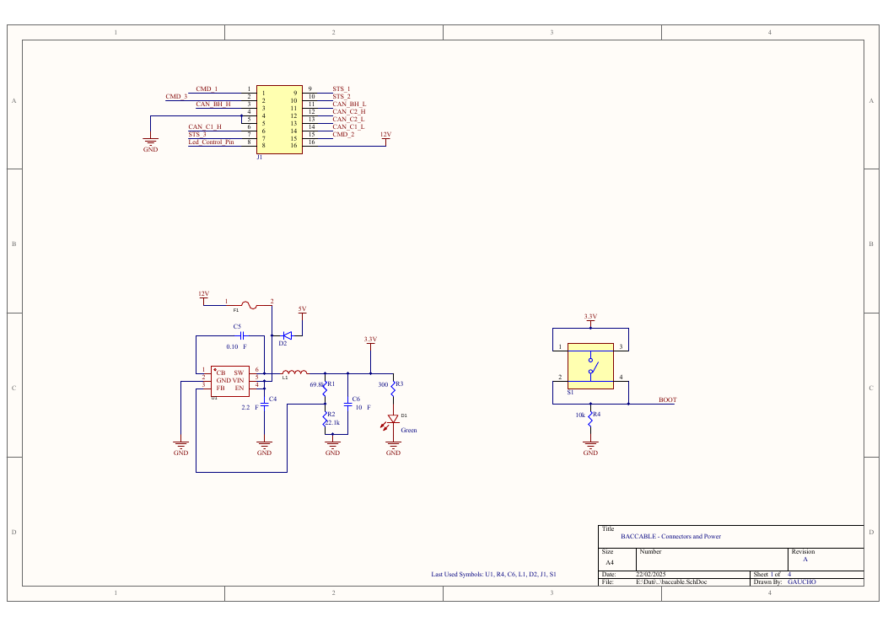

*Source: `hardware/newBaccableDedicatedPcb/BACCABLE_SCHEMATIC.pdf`, sheet 1. Top: OBD plug J1 (pin 16 = 12 V, 4/5 = GND, CAN pins). Middle: **12 V → fuse F1 → buck U1 → 3.3 V** (R1 69.8 kΩ / R2 22.1 kΩ set the output), **D2 from the 5 V (USB) net into the buck input**, green power LED D1. Right: programming button **S1** pulling **BOOT** high for all three chips (R4 10 kΩ pull-down).*

### 4.2 Parts and settings
- **Fuse:** inline fuse holder + **1 A** fuse, as close to the OBD plug as possible.
- **Buck:** automotive **12 → 3.3 V** step-down module (fixed 3.3 V, or adjustable set to 3.3 V): input rated well above 14 V (≈ 30 V or more, for load-dump spikes — the author's U1 is rated 4.5–35 V), output **≥ 0.5 A**, **low no-load current** (it is never switched off).
- **Set and check the output at 3.30 V (3.2–3.4 V) with no board connected.** The STM32F072 and the CAN transceivers must never see more than 3.6 V (datasheet in `hardware/canable/`). Re-check after the box is closed if the module has a trim pot.
- **Per board:** a small **2-pin plug** (3V3 + G) so each board can be disconnected from the rail on its own; 22–24 AWG wire.
- **Ground:** buck ground, the three G pads and the three CAN-terminal GND pins all go to OBD 4/5 (one common ground).

### 4.3 The one rule this design adds
The author's PCB can take a PC's USB 5 V at the same time because USB feeds his buck through **diode D2** (my reading of the drawing [Infer]); **a UCAN has no such diode**. So:
> **Never plug a USB cable into a board while its 3V3 plug is connected.** First unplug that board's 3V3 plug, then connect USB (the board then runs from the PC), and reconnect the 3V3 plug only after removing the USB cable.

Otherwise the board's own regulator and the buck would both drive its 3.3 V rail. This applies to flashing (§8), ELM327 and the built-in sniffer (§11.9). [Infer]

**Bench check of the back-feed path (H7):** with a board fed on its 3V3 pad and nothing in its USB-C, measure the USB-C **VBUS** (e.g. with a USB-C breakout or at the regulator input): a reading near 0 V means the UCAN regulator blocks reverse current; a reading of a few volts means 3.3 V leaks back to VBUS — harmless while nothing is plugged in, and the rule above already covers it. [Infer]

### 4.4 Checks before relying on it
- **Bypass cable carries pin 16:** car off, measure **pin 16 ↔ pin 4 ≈ 12 V** on the bypass cable's OBD port (some bypass cables carry only the CAN pins and ground). First action of H6.
- Why always-on: with the boards powered and sleeping, what the author's device keeps in RAM survives a parked car (DNA Memory, the exhaust-flap remembered choice) and — if you ever enable it — the immobilizer stays armed. On your car DNA Memory does not apply (§11.12) and there are no exhaust valves, but always-on 12 V is the author's design and keeps those options open. [Repo]
- **Parked current:** measure in H11 (author's device ≈ 15 mA asleep).

### 4.5 Fallbacks (not chosen)
- **Option A:** pin 16 → fuse → 12→5 V buck (≥ 1 A) → power-only USB-C leads. Same source, one extra regulator stage per board (a bit more parked current); USB service is just swapping leads.
- **Car USB:** 5 V from the console USB or the port near the cigarette lighter (manual §1.7/§2.4: switched on when you get in and when the RF hub wakes) → passive splitter → power-only USB-C leads. Boards lose power when the car sleeps, so DNA Memory and remembered states are lost; otherwise works.

  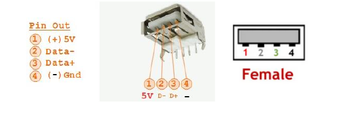

  *Source: manual §1.7, page 10 — pin 1 = +5 V, pin 4 = GND of the car's USB-A socket (the manual's way to tap the console USB hub).*

Rules for every option: **never put 12 V on a UCAN**; one common ground; C2/BH show up as USB pen drives on a data connection (§11.4), so USB-C power leads, if used, must be power-only.

### 4.6 Check: does your UCAN's CAN chip run on 3.3 V or 5 V?
**Why it matters:** FYSETC's schematic has a note with two possible factory builds of the transceiver U1. [FYSETC]

| Build | Transceiver | U1 supply (pin 3) | Fitted resistor |
|---|---|---|---|
| A (drawn in the schematic) | **SN65HVD230** (printed **VP230**) | **3.3 V**, from the board's 3.3 V rail | R22 |
| B | **SIT1051T/3** or **MP2542** | **5 V**, from the **USB** 5 V only | R23 |

Our power design (Option B) feeds only the 3.3 V pads. On a **build B** board, U1 would then have **no supply at all**, and that board would never see the car. Everything else would look fine: LEDs on, firmware running.

**How to check each board (part of H0):**
1. Read the marking on U1, the 8-pin chip next to the green terminal.
2. Power the board from USB only, with no power plug, and measure **U1 pin 3 to G**.

| Reading | Meaning | What to do |
|---|---|---|
| **≈ 3.3 V** | build A | our 3.3 V power is correct |
| **≈ 5 V** | build B | power that board with **5 V into its USB-C** (Option A in §4.5: 12 → 5 V converter and a power-only USB-C lead) instead of the 3.3 V plug |

Using Option A for all three boards keeps the build simple if any board is build B. The plan's other rules don't change:
- never USB data and the power lead on the same board;
- for flashing, swap the power lead for the laptop's data cable. [FYSETC][Infer]

---

## 5. Sleep (low consume) on UCAN boards — identical to the author

**Author's design** (`lowConsume.c`, schematic): C1 never sleeps; after **3.5 s without CAN frames** on its bus it pulls **PA4** low (open-drain) to hold C2 and BH in reset, drives **PA5** to put their transceivers in standby, pauses the serial line and flashes its blue LED; when frames come back it releases both, restarts the serial line, re-sends every function setting to the slaves (≈ 3.5 s later) and arms DNA Memory. Sleep is blocked while a sniffer/ELM327/pen-drive USB session is active. [Repo]

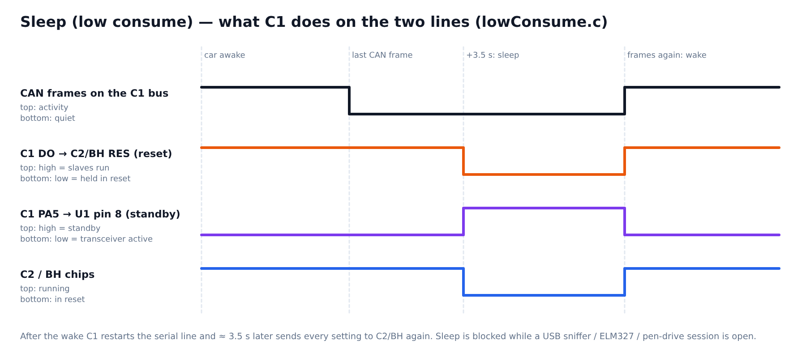

**Problem on a UCAN:** PA4 and PA5 have no pads. Solved line by line below.

### 5.1 Reset line (author's PA4)
**Fix in this fork:** new compile flag **`UCAN_LOW_CONSUME_PINS`** in `Core/Inc/lowConsume.h` moves the reset line to **PA13 = the DO pad** (the pin GiUCAN uses for exactly this, wired to the other board's RES pad). Default builds are unchanged. Verified in the C1 image's disassembly: PA13 open-drain output. [Repo][GiUCAN][Built]
- PA13 is SWDIO: SWD debugging of C1 is no longer possible; USB-DFU flashing is unaffected. At C1 power-up and during C1 flashing PA13 is not driven, and each slave's own RES pull-up (R9 10 kΩ) keeps the line high, so the slaves run. [FYSETC][Infer]

### 5.2 Standby line (author's PA5) — no firmware change needed
- The firmware **already drives PA5 exactly as the author's**: push-pull output, **low = slave transceivers active** (set at start-up and on every wake), **high = standby** (set when C1 goes to sleep). Our flag only moved the reset line; PA5 is untouched. [Repo: `lowConsume.c`]
- On the author's PCB PA5 runs to the **RS pin (pin 8)** of the C2 and BH transceivers (schematic sheets 3/4, `CanLowConsumeCmd`, one 10 kΩ pull-down R27 drawn on the C2 sheet). On a UCAN the transceiver's standby/silent pin (**pin 8, "S"/"RS"**) is wired to that board's own **PC13** (GiUCAN calls it `CAN_S`, "can silent pin"); the BACCAble C2/BH firmware **never drives PC13**, so an external line can control it without a conflict. [Repo][GiUCAN]
- **Wiring:** one thin wire (30 AWG wire-wrap or enamelled) from **C1's chip pin 15 = PA5** (LQFP48 numbering from the MKS CANable schematic in the repo: PA4 = 14, PA5 = 15) to **pin 8 of the CAN transceiver** (the 8-pin chip next to the green terminal) on **C2** and on **BH**. Pin 15 is the 3rd pin from the right on the chip's top side (USB on the left; how to confirm it: §2.2). The pitch is 0.5 mm: use flux and a fine tip, and check with a loupe that pins 14/16 are not bridged.
- **Before soldering, identify pin 8 on your boards:** pin 1 is marked by the dot; pin 8 is the pin beside pin 1 on the opposite row. Confirm with the multimeter: **continuity between transceiver pin 8 and the board's chip pin 2 (PC13)**. If there is no continuity, stop and re-check (the board differs from GiUCAN's). [Infer]
- **Result:** during sleep the slaves are held in reset **and** their transceivers are in standby/silent mode — the author's exact behaviour and the lowest sleep current. At start-up, before C1's firmware sets PA5, the line is held low by each slave's own **R18 10 kΩ to GND** (R4 removed in H1, §2.2), so the transceivers stay active, as with the author's R27 pull-down. Even if R4 were left in, the line would sit at about half the supply, still below the SN65HVD230's standby threshold (≈ 0.75 × 3.3 V). Load on PA5: ≈ 0.33 mA per slave, well within the pin's rating. [FYSETC][Infer]
- *Optional, fully pin-identical variant:* also take the reset line from C1's chip **pin 14 (PA4)** instead of the DO pad and build C1 **without** `-DUCAN_LOW_CONSUME_PINS` (the author's stock pins). Same behaviour, but one more fine-pitch joint next to pin 15; the DO-pad route is the easier one.

### 5.3 Bench note
- **Bench gotcha:** with no car, C1 sees no CAN frames and holds C2/BH in reset after 3.5 s. Flash and test the slaves **before** fitting the reset wire, or power C1 off, or use the `C1_BENCH_ONLY` image (§8).

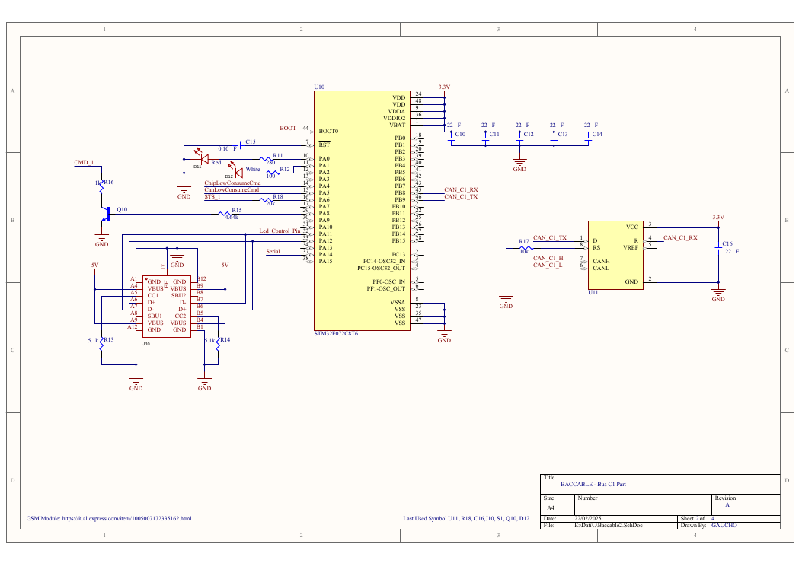

*Source: `BACCABLE_SCHEMATIC.pdf`, sheet 2 (C1). On the left of the chip: **PA0 red LED, PA1 white LED, PA4 `ChipLowConsumeCmd`** (reset of C2/BH — our DO-pad wire), **PA5 `CanLowConsumeCmd`** (standby of the C2/BH transceivers — our fine wire from chip pin 15, §5.2), PA6 STS_1, PA8 → Q10 → CMD_1, PA11 `Led_Control_Pin` (LED strip, excluded), PA11/PA12 USB-C J10, **PA14 `Serial`** (our CK wire), BOOT0 ← BOOT. Right: CAN on **PB8/PB9** to transceiver U11. Sheets 3 and 4 repeat this for C2 (blue LED, plus an unused GSM footprint) and BH (yellow LED); there `ChipLowConsumeCmd` arrives on the chip's **NRST** and `CanLowConsumeCmd` on the transceiver's **RS** pin.*

---

## 6. Termination

The car buses are already terminated (≈ 60 Ω each), and the author's PCB adds **no** terminator (his diagrams say "TERMINATION NOT INSERTED"). So no board of ours may add one. [Repo]

**What a UCAN has** (FYSETC, §2.2): [FYSETC]
- **README:** "On-board termination resistors (2 x 59R) are used by default", so the board ships terminated.
- **Schematic:** **R1 + R2 = 59 Ω + 59 Ω in series across CAN_H–CAN_L (≈ 118 Ω)**, permanently connected.
- **The header JP1:** the README calls it "enable/disable termination", but the schematic shows it adds a **second** terminator (R3 120 Ω) when a jumper is fitted.

**Your H0 measurement decides which description your boards follow** (unpowered, no jumper on JP1, meter across CAN_H–CAN_L on P1):
- **≈ 118 Ω:** R1 + R2 are hard-wired, as in the schematic. Do steps 1–4 below.
- **Open (tens of kΩ or more):** the header controls the terminator and it is already off. Remove nothing, and just keep JP1 open.
- **≈ 60 Ω:** a jumper is on JP1. Take it off and measure again.

Left as delivered, each of our boards would put ≈ 118 Ω on its bus. 60 Ω ∥ 118 Ω ≈ 40 Ω on every bus, which risks bus errors and warning lights.

**What to do on C1, C2 and BH:**
1. **Remove R1 and R2.** They are the two larger resistors between the transceiver U1 and the green terminal P1 (component-position drawing, §2.2). Lift them with two irons or hot tweezers, or heat one end at a time. Practise on the spare first (drawing in §2.2).
2. **Keep JP1 open** (no jumper).
3. Leave C4, C5, C6 and TVS1 in place. With R1/R2 gone, C4 and the 0 Ω R17 have nothing to do and are harmless.
4. **Remove R1/R2 on the spare too** if it will sniff the car buses (S5).

**Check:** board unpowered, CAN_H↔CAN_L reads **≈ 118 Ω before** (H0) and **well above 1 kΩ after** (H1). Through the full harness in the car, every bus must still read **≈ 60 Ω** (H10).

The author's older single-CANable diagram is where "TERMINATION NOT INSERTED" comes from (the CANable's termination jumper left open). It is a **legacy design — do not build it**: its Start&Stop resistor panel and the 1.5 kΩ resistor on PA14 are obsolete (Start&Stop is now done over CAN and PA14 is the serial wire), and its LED-strip output is out of scope.


*Source: `hardware/system_interconnection/SCHEMA_DI_INTERCONNESSIONE.png`.*

---

## 7. Hardware build steps (no firmware yet)

**Parts:** 3 UCAN + 1 spare (owned); OBD2 male plug (populate only 3, 4, 5, 6, 11, 12, 13, 14, 16 — §2.3.2); 12 → 3.3 V automotive buck (§4.2) + inline fuse holder + 1 A fuse; 3 small **polarised** 2-pin plugs (3V3 + G, one per board); 22–24 AWG wire for three H/L/GND trios and power (~3 m), 26 AWG for serial/reset, 30 AWG wire-wrap or enamelled wire for the standby line; 2.54 mm pin headers; 4 small momentary push buttons (boot, normally open); a clear lid or 3 mm light pipes for the LEDs; 1 short USB-C **data** cable for flashing; project box, standoffs, cable glands, heat-shrink, ferrules. Tools: multimeter, fine-tip iron (plus hot tweezers or a second iron for R1/R2), flux, wick, tweezers, loupe, Kapton tape; a 12 V bench supply (or 12 V battery) to run the buck on the bench, and a 5 V USB supply for single-board tests.

**Shopping list with examples.** Any equivalent part is fine. The examples only show what to look for.

| Item | Qty | What to look for | Example |
|---|---|---|---|
| FYSETC UCAN V1.0 | 3 + 1 spare | STM32F072**CB**, 128 KB | owned |
| 12 → 3.3 V step-down converter | 1 | input up to ≈ 30–36 V, output ≥ 0.5 A, small idle current | Pololu D24V5F3 (3.3 V, 500 mA, 4–36 V in) |
| 12 → 5 V converter (only if §4.6 finds a 5 V transceiver) | 1 | same, 5 V output | Pololu D24V5F5 |
| Inline fuse holder + fuse | 1 + spares | mini blade (ATM) holder, **1 A** fuse | any automotive mini-blade holder |
| OBD2 male plug | 1 | 16-pin male, solder cups or loose pins | "OBD2 male connector DIY" |
| Wire for the CAN cables | ≈ 2 m | twisted pairs, 22–24 AWG | **Cat5e/Cat6 network cable**: four twisted pairs inside, ideal for H/L/GND |
| Wire for power | ≈ 1 m | 22 AWG, red + black | silicone hook-up wire |
| Wire for serial and reset | ≈ 1 m | 26 AWG | silicone hook-up wire |
| Wire for the standby line | short | 30 AWG | Kynar wire-wrap wire |
| Polarised 2-pin plugs | 3 pairs | cannot be plugged in reversed | JST-XH or JST-PH 2-pin |
| Push buttons (boot) | 3 | momentary, normally open | 6 × 6 mm tactile, or 12 mm panel-mount |
| Light pipes / clear lid | 9 or 1 | to see the dim LEDs | 3 mm light pipes |
| Project box, standoffs, cable gland | 1 set | room for 3 boards + converter | 3D-printed or ABS box |
| Data USB-C cable | 1 | must carry data (not a charge-only cable) | — |

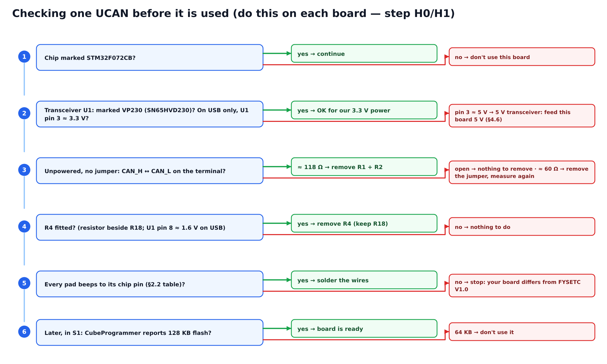

**Order:** do H0–H2 and H5–H7 first. Load the firmware next (S1–S2 in §9). Then fit the board-to-board wires H3–H4 and run the bench tests S3–S4. Finish with H8–H11. This is the order of §0.3.

| Step | Action | Pass when |
|---|---|---|
| **H0** | Inspect every board: chip marking **STM32F072CB**, transceiver **SN65HVD230** (or 230-compatible); label C1, C2, BH, SPARE. Unpowered, JP1 open: measure CAN_H↔CAN_L on P1. Identify every pad with the continuity table in §2.2. Check whether **R4** is fitted (resistor beside R18; or, powered from USB, U1 pin 8 reads ≈ 1.6 V instead of ≈ 0 V). | ≈ 118 Ω (the fixed R1 + R2, FYSETC's "used by default"); if a jumper sits on JP1, take it off first; every pad beeps to the chip pin listed; R4 noted; **U1 marked VP230 and U1 pin 3 ≈ 3.3 V on USB** (≈ 5 V → §4.6) |
| **H1** | **Remove R1 and R2** (when H0 read ≈ 118 Ω) on C1, C2, BH (and the spare if it will sniff the car) — §6; practise on the spare. Keep JP1 open. **If R4 is fitted, remove it** on C1, C2, BH, so each RS pin has only R18 10 kΩ to GND, as on the author's PCB. | CAN_H↔CAN_L ≫ 1 kΩ on each board; U1 pin 8 ↔ G ≈ 10 kΩ; no solder bridges near U1/P1 |
| **H2** | Flash check comes in S1 (needs USB). On every board: wire or header the P2 pads **CK, B0, 3V3** and the P3 pads **3V3, G**. On C1 add **DO**, on C2/BH add **RES**. Fit the boot button **B0 ↔ P2 3V3** on each board (W18–W20, §2.3.4). | pads clean, no bridges; button pressed = B0 beeps to 3V3 |
| **H3** | **Serial wire:** C1.CK ↔ C2.CK ↔ BH.CK. | continuity CK-CK-CK, no short to G/3V3 |
| **H4** | **Reset wire:** C1.DO ↔ C2.RES and C1.DO ↔ BH.RES. **Standby wire (§5.2):** first check continuity *transceiver pin 8 ↔ chip pin 2* on C2 and BH, then wire C1 chip pin 15 (PA5) → transceiver pin 8 of C2 and of BH; check pins 14/16 of C1 are not bridged. *(Leave unplugged until the slaves are flashed — §5 bench gotcha.)* | continuity, no short |
| **H5** | **OBD plug and CAN harness** (W1–W10, §2.3.2–2.3.3): populate only OBD 3, 4, 5, 6, 11, 12, 13, 14, 16; join 4 + 5 at the ground star. To each terminal (P1: 1 = CAN_L, 2 = CAN_H, 3 = GND): C1 → 6/14, C2 → 12/13, BH → 3/11, P1-3 → ground star. Twist each H/L/GND trio, mark every H wire, ≤ 30 cm. | H/L not swapped (swapped = warning lights, manual §1.5); no continuity between any CAN pin and 16 or 4/5 |
| **H6** | **Power harness** (§4): first measure **pin 16 ↔ pin 4 ≈ 12 V** on the bypass cable's port (no 12 V → fallback car USB, §4.5). Then OBD 16 → fuse 1 A → 12→3.3 V buck → three polarised 2-pin plugs → P3 3V3 / P3 G of each board (W11–W14); buck GND → ground star. On the bench, with **no board connected**, power the buck from 12 V and set/check its output. | 12 V on pin 16; buck out **3.30 V ± 0.1 V** |
| **H7** | **Bench power test:** connect one board's 3V3 plug (USB-C empty): power LED on, 3V3 pad 3.3 V; measure its USB-C VBUS (back-feed check, §4.3). Then all three plugs. Separately confirm each board also runs from USB alone with its 3V3 plug **removed**. | no short, no hot parts, rail stays 3.2–3.4 V |
| **H8** | **Bypass cable check** (car asleep ≥ 10 min, boards unplugged): 6↔14, 12↔13 ≈ 60 Ω; 3↔11 low value; 16↔4 ≈ 12 V; 4/5↔chassis continuity. | all present (owner already confirmed the buses) |
| **H9** | **Box (holds all three UCANs + buck + fuse):** standoffs, glands, strain relief; USB-C ports and boot buttons reachable; a clear lid or windows over LD1/LD2/LD3 of each board (§2.3.5); away from pedals, steering column, knee-airbag path, heat and HVAC flaps. Label boards at both ends. | nothing loose |
| **H10** | **In-car, unpowered:** plug into the bypass port, re-measure every bus ≈ 60 Ω through the harness, connect power last. Do not power the boards on the car with unknown firmware. | ≈ 60 Ω each |
| **H11** | (Always-on option) after the firmware is in (S5): measure the 12 V current at the fuse with the car awake and ≈ 1 min after it sleeps (author's device: ≈ 15 mA asleep, < 30 mA running). | sleep current settles; boards wake when you unlock |

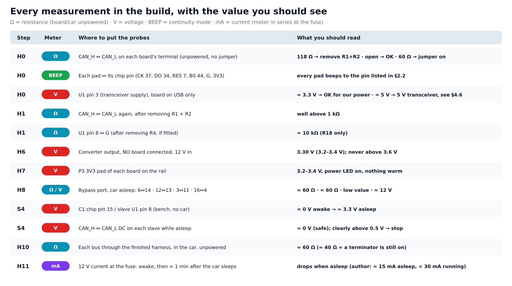

---

## 8. Firmware — what we build and how to flash it

**Only change to the author's code:** the `UCAN_LOW_CONSUME_PINS` flag (§5). Everything else is the author's firmware. [Repo]

**Build** (tested, ARM GCC 13.2; `apt install gcc-arm-none-eabi libnewlib-arm-none-eabi`): run `docs/build_ucan.sh`. It writes `firmware/ucan_prebuilt/` (prebuilt copies are committed there):

| Image | Flags (besides `-DRELEASE_FLAVOR=…`) | Size [Built] |
|---|---|---|
| `C1` | `-DIS_GASOLINE -DUCAN_LOW_CONSUME_PINS -DDISABLE_IMMOBILIZER -DDISABLE_THE_FUNCTION_SMART_DISABLE_START_STOP` | 79,004 B |
| `C1_BENCH_ONLY` | same + `-DDEBUG_CAN_RX_SIMULATION` (CAN in silent loopback, simulated frames; **never in the car**) | 79,080 B |
| `C2`, `BH` | none (stock) | 37,532 B / 36,800 B |
| `SNIFFER_ActAsCanable` | `CAN_FLAVOR` (plain SLCAN sniffer for SavvyCAN, for the spare) | 25,644 B |

Checked with the preprocessor: `LOW_CONSUME` defined; `IMMOBILIZER_ENABLED`, `SMART_DISABLE_START_STOP`, `IS_DIESEL` undefined. The defaults apply only to a board whose settings flash page is blank, so **erase the whole chip** when flashing a board that ran BACCAble before (CubeProgrammer "Full chip erase"; with dfu-util the DfuSe option `-s 0x08000000:mass-erase:force:leave` should do the same [Infer]). A new UCAN's settings pages are expected to be blank. The fork's "Build Beta Version" GitHub workflow accepts the same flags in its `CFLAGS` input. [Repo][Built]

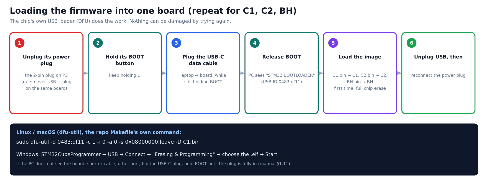

**Flash a UCAN** (documented in the repo for loose boards): **unplug the board's 3V3 plug first** (§4.3), then hold the **B0** button while plugging the **data** USB-C cable (the chip appears as `0483:df11`), then either
```bash
sudo dfu-util -d 0483:df11 -c 1 -i 0 -a 0 -s 0x08000000:leave -D C1.bin
```
(the Makefile's own `flash` target, `MAKEFILE.md`) or STM32CubeProgrammer → USB → "Erasing & Programming" with the `.elf` (GiUCAN's docs). On Windows install the WinUSB driver with Zadig if CubeProgrammer/DfuSe is not installed (manual §1.11.1). Weak LED or no detection: shorter cable, another port, a slow USB hub, flip the USB-C plug (manual). The firmware has no software jump to the bootloader, so the button is the only way in. [Repo][GiUCAN]

**Updating the firmware later** (for example after the author releases fixes): [Repo][Infer]
1. Bring the new upstream code into this fork.
2. Run `docs/build_ucan.sh` again. The images get a new `ucan-<hash>` version tag.
3. Load the new image into each board as above, **without** a full chip erase.
   - The images end far below the settings pages (C1 code ≤ 96 KB, settings from `0x0801E800`; C2/BH code ≤ 60 KB, USB drive from `0x08010000`), so normal programming keeps your saved menu settings and the C2/BH drive.
   - A full chip erase restores the defaults of §11.8; use it only if something behaves strangely.
4. Check the version in the dashboard menu: `BACCABLE ucan-…`.

**Building in STM32CubeIDE instead** (the author's way): open `firmware/ledsStripController`, pick the build configuration from the hammer menu, and add our C1 flags to that configuration's preprocessor symbols (or use a "+ user_config" configuration with a `user_config.h`).


*Source: `hardware/system_interconnection/compileOptions.jpg` (README). The screenshot is older: today's `.cproject` has ReleaseC1/C2/BH BACCAble, each also "+ user_config", and ReleaseCANable; diesel/gasoline is now a menu setting (or `-DIS_GASOLINE`).*

---

## 9. Bring-up steps

| Step | Action | Pass when |
|---|---|---|
| **S1** | On the **spare**: read device ID and **flash size = 128 KB** in CubeProgrammer, flash `BH`, unplug, replug. | on the data cable it appears as a USB drive "BACCABLE BH" with `Version.txt` (that proves it booted; the label and file are written when the drive is first formatted, i.e. on a blank or fully erased chip); no steady red blinking |
| **S2** | Read and flash all boards: `C1`→C1 board, `C2`→C2, `BH`→BH (full chip erase). Reset wire **not** fitted yet. | no steady red blinking on any board; C2/BH show their USB drive label on a data cable |
| **S3** | **Bench serial test:** flash `C1_BENCH_ONLY` on C1, fit the CK wire, power all three. | after ~3 s the blue LEDs of C2 and BH pulse about once a second (C1 polling them) |
| **S4** | **Bench sleep test:** flash the real `C1`, fit the reset wire, power all three with no car. | ~4 s after power-up the status LEDs of C2 and BH stop (held in reset; their power LEDs stay on) and C1's blue LED flashes once: the reset wire works. **Standby check:** C1 pin 15 / slave transceiver pin 8 read ≈ 0 V while awake and ≈ 3.3 V once asleep (the standby wire works). **Bus-safety check:** while they are held in reset, measure DC volts between CAN_H and CAN_L on each slave's terminal (nothing else connected): **≈ 0 V = recessive, safe**; anything clearly above ≈ 0.5 V means the slave would hold its bus dominant — do not install it (§5) |
| **S5** | **Car, silent sniff (optional but recommended):** flash `SNIFFER_ActAsCanable` on the spare and use SavvyCAN in silent mode (`M1`) on each bus (500 k C1/C2, 125 k BH); the IDs in §11.5 should appear — on the BH bus look specifically for `0x256` and `0x46C`, which DNA Memory needs (§11.12). Then install the three boards (H10) and power them. | no warning lights; with always-on power the boards wake on unlock (blue LEDs active again) |
| **S6** | **First start:** engine running, cruise control and ACC off → hold **RES** (or DISTANCE) ~2 s → version `BACCABLE ucan-…` on the cluster. With our defaults there is **no** double blue blink and no cluster flash at power-up (those mean "immobilizer active"). Open **SETUP MENU** (§11.7): check **Diesel Params = O** (gasoline), **My23 IPC = O**, Start&Stop = O. | menu works |
| **S7** | Enable functions **one at a time**, SAVE & EXIT, ignition cycle, check for faults after each: dashboard parameters → shift → seat-belt/odometer → windows, park mirror, park mute → proxy-alignment features (ACC pad, HAS pad, race mask). Leave **DNA Memory off** (selector not compatible, §11.12). | no new faults |
| **S8** | **Last, stationary / closed course only:** 4WD disabler (C1), ESC/TC, DYNO, front-brake override (C2). Prove the way back first: disable in the menu, ignition cycle, Clear Faults. The 4WD disabler also switches itself off whenever the engine stops (`processingMessage0x000000FC.c`). | rollback works |

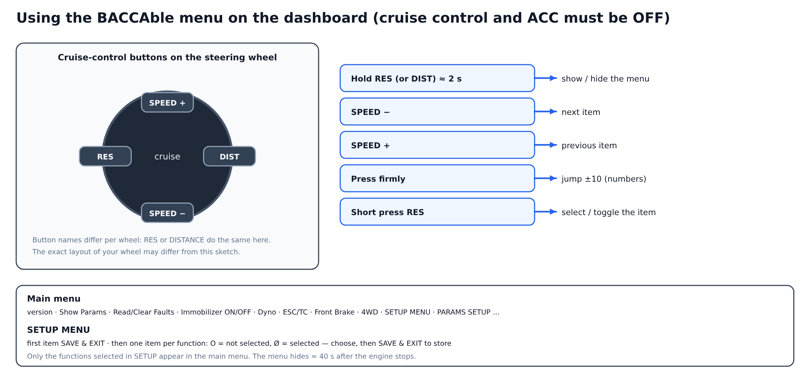

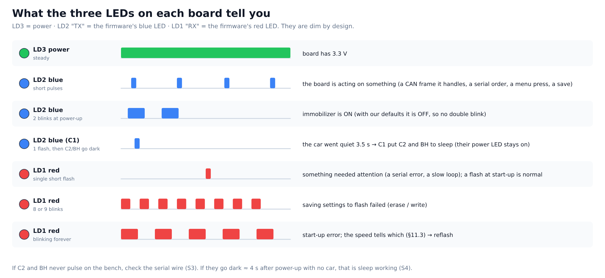

### 9.1 Troubleshooting — symptom, likely cause, what to do
| Symptom | Likely cause | What to do |
|---|---|---|
| PC does not see the board (no `0483:df11`) | BOOT not held while plugging in; charge-only cable; B0 button wired wrong | hold BOOT until the plug is fully in, use a data cable, check B0 ↔ 3V3 with the meter when pressed |
| Power LED off on the rail | plug reversed, converter not set, broken wire | measure the converter output with no board (H6), check the plug polarity |
| Red LED blinking forever | start-up error (the blink speed tells which, §11.3) | reflash with a full chip erase; check that the 3.3 V rail is 3.2–3.4 V |
| On the bench C2/BH never pulse (S3) | CK wire missing or on the wrong pad, slaves not flashed, C1 not running `C1_BENCH_ONLY` | beep CK–CK–CK, reflash, check each board alone on USB |
| On the bench C2/BH go dark ≈ 4 s after power-up | **normal**: no car = no CAN frames = C1 puts them to sleep | flash C2/BH before fitting the reset wire, or use `C1_BENCH_ONLY` (§5.3) |
| A board works on USB but not on the 3.3 V rail in the car | 5 V transceiver build (§4.6) | measure U1 pin 3; feed that board 5 V through USB-C |
| Warning lights right after installing | CAN_H/CAN_L swapped, or a terminator still fitted (bus ≈ 40 Ω) | unplug at once; re-measure each bus (H10) and the wiring (H5) |
| No BACCAble menu on the cluster | cruise control or ACC on; RES not held ≈ 2 s; BH not working (it writes the text); C1 wires swapped | check §9 picture conditions, BH wiring (OBD 3/11, 125 kbit/s), C1 wiring |
| ESC/TC, DYNO or brake override do nothing | C2 wiring, or race mode not enabled by proxy alignment | check C2 (OBD 12/13); see §11.10 |
| Parked current does not drop (H11) | reset wire not fitted, a USB cable left in a board, sniffer/ELM327 left enabled | remove USB cables, deselect Sniffer/ELM327, check the reset wire (S4) |
| Settings lost after reflashing | full chip erase was used | expected: set them again in SETUP, then SAVE & EXIT |

---

## 10. Optional author I/O (not needed for the car functions)

*Skip this section unless you add aftermarket exhaust valves.*

- **Aftermarket exhaust-valve remote** ("Exhaust Flap" with non-QV radio-remote valves; manual §2.30, upstream issue #40): the C1 firmware pulses **PA8 (`Q10mosfet`, "open")** and **PA7 (`Q11mosfet`, "close")** high for ≈ 1 s to press the remote's buttons (`functions_C1baccable.c`). The author's schematic (sheet 2) has only the PA8 stage: **PA8 → R15 4.64 kΩ → base of NPN Q10, emitter to GND, collector → R16 1 kΩ → `CMD_1` (OBD pin 1)**. On a UCAN these pins have no pad: copy that stage on a fine wire from the C1 chip's **pin 29 (PA8)**, and an identical one on **pin 17 (PA7)** if you need "close"; each collector goes across one button of the remote. Only if you fit such valves; your 2.0 Sprint has no factory valves, so the CAN "QV" mode does not apply. [Repo][Infer]
- **Pedal booster ("schizzaForte")** on C1 **USART1, PB6 = pin 42**, half-duplex 9600 baud: manual says "under development, do not activate". Not wired. [Repo]
- **LED strip (PA11): excluded by the mission.** Leave "Led Controller" deselected in SETUP.

---

## 11. Reference — how the firmware works (read from this fork)

*You don't need this section to build. It explains what the firmware does, for checking and troubleshooting.*

### 11.1 Start-up and main loop
Clocks (internal HSI48, no crystal) → LEDs → CAN init → C1 loads settings from flash → serial (USART2 on PA14) → C2/BH format/mount their flash drive and start USB at power-on → C1 and C2 open CAN at 500 k, BH at 125 k (accept-all filter). Main loop: LEDs, CAN transmit queue, serial queue, flavor periodic function, CAN receive → per-ID handlers. A loop iteration longer than 2 ms lights the red LED. [Repo]

### 11.2 Serial protocol between the boards
Fixed-length frames, first byte = destination (C1 0x01, C2 0x02, BH text 0x03, BH status 0x08, BH 0x0A, C2+BH 0x0B, C1+BH 0x0C, C1+C2 0x0D; ELM327 bridge 0x0E–0x10). Only C1 starts: one message every ≈ 250 ms; C2/BH may answer only within ≈ 200 ms of a message to them; for "both slaves" messages only C2 answers. For the first 2 s after boot or wake the chips ignore serial traffic. From ≈ 3 s, C1 polls C2 every ≈ 1.0 s and BH every ≈ 1.26 s, and at ≈ 3.5 s it sends all function settings. C1 never waits for an answer. [Repo]

### 11.3 LEDs
On a UCAN: blue = **LD2 "TX"**, red = **LD1 "RX"**, power = **LD3 "3V3"** (§2.3.5). Blue (PA1) short pulses = activity (CAN frames handled, serial frames, settings saved, wake). Red (PA0) = attention (serial error, failed flash save, slow loop). Red blinking 8× / 9× = flash erase / write failed. Red blinking forever = start-up error (rate shows which: 500 ms serial, 750 ms USART1, 1000/1500/2000/2500 ms USB clock, system clock, oscillator, DMA). Blue blinks twice at power-up only when the immobilizer is active. [Repo]

### 11.4 Flash map and USB
C1 settings `0x0801F800` (33 values), statistics `0x0801F000`, shown parameters `0x0801E800`. C2/BH: 60 KB code region, a 64 KB FAT drive at `0x08010000–0x0801FFFF` ("BACCABLE C2/BH", `Version.txt`), BH mirror positions at `0x0801F800`. C1 starts USB only for sniffer/ELM327; C2/BH start their USB drive at power-on (not after a reset). PA14 is the serial line, so SWD is not usable on any board. [Repo]

### 11.5 CAN IDs each board reads (for the S5 sniff)
IDs the code actually acts on (`processingStandardMessage.c`):

| Board | IDs |
|---|---|
| C1 | 0x0FB, 0x101, 0x107, 0x192, 0x1F7, 0x2EF, 0x412, 0x41A, 0x41E, 0x420, 0x4AF, 0x4B1, 0x4B2, 0x545, 0x5A5, 0x5A8, 0x5AE, 0x73C, 0x73E |
| BH | 0x090, 0x256, 0x25A, 0x354, 0x356, 0x3E6, 0x3E8, 0x46C, 0x5A0, 0x5A6, 0x5A8, 0x5AC |
| C2 | 0x1F5, 0x3E7, 0x4AF, 0x4B4, 0x54A, 0x5B0 |
| All boards | 0x0FC, 0x1EF, 0x226, 0x2ED, 0x2FA, 0x384 |

The code also has comment-only notes, with no action, for 0x0FA, 0x116, 0x1F0, 0x1FC, 0x2EE, 0x358, 0x5CA and 0x73A. [Repo]

### 11.6 How functions act on the car
The boards are bus participants, not a gateway: to change something they receive a frame and immediately send a modified copy with the same ID and a recomputed CRC (drive style 0x384, shift 0x2ED, key fob 0x1EF, steering buttons 0x2FA), or use UDS requests (parameters, seat-belt, read/clear faults, DYNO, exhaust QV). Engine "on" = rpm > 400 from 0x0FC; most functions wait ≈ 5 s of engine running. [Repo]

### 11.7 Dashboard menu
Driven by the steering-wheel buttons (0x2FA), only with cruise control and ACC off. Hold RES/DISTANCE ≈ 2 s to show/hide; short press selects; speed-down = next, speed-up = previous, firm press = ±10. **Main menu:** version · Show Params · Read Faults · Clear Faults · Immobilizer ON/OFF · Dyno · ESC/TC · Front Brake · 4WD · SETUP MENU · PARAMS SETUP MENU · HAS · Exhaust Flap · "Save Log" (test stub, ignore) · Reset statistics · Max Hold (disabled functions are skipped). **SETUP MENU:** SAVE & EXIT · Start&Stop · Launch Torque · Led Controller (leave off) · Shift indicator · Shift RPM · My23 IPC · Regen alert · Seat-belt alarm · Route · ESC/TC · Dyno · ACC pad · Brakes override · 4WD disabler · Clear faults · Read faults · Remote start (do not enable) · **Diesel Params** · Odometer blink · Pedal booster (do not enable) · Pedal power · Park mirror · ACC autostart · Close windows · Open windows · HAS pad · Exhaust flap · Front park mute · Sniffer · ELM327 · DNA Memory. There is no immobilizer item: toggle it with engine running, cruise/ACC off, gear in neutral, holding cruise **speed-up** ≈ 20 s (manual says 30–40 s) until the cluster blinks (3 blinks = ON, 6 = OFF). The menu hides ≈ 40 s after the engine stops. [Repo]

### 11.8 Fresh-board defaults (`readFromFlash()`), with our C1 flags
Immobilizer **OFF**, Start&Stop disabler **OFF**, gasoline, Clear Faults ON, seat-belt alarm "enabled"; everything else OFF. Note: the seat-belt setting has no "leave untouched" choice — about 2 s after the first engine start after C1 powers up (and again only if that attempt timed out), C1 writes it to the cluster (`2F 55A0 03 01` = chime on, stock behaviour; `00` if you deselect it). [Repo]

### 11.9 ELM327 mode (manual §2.32)
**What it does:** C1 answers as "ELM327 v1.4" for MultiECUScan or AlfaOBD. It forwards requests for ECUs on the other buses over the serial wire to C2/BH, which is why all three boards matter for proxy alignment.

**Rules from the code:**
- While a laptop is connected, the dashboard buttons are ignored.
- The mode switches itself off after 120 s without commands, and waits 3 min for a laptop that went away.
- **The laptop must see the USB device within 10 s** of the function starting (`SNIFFER_ACTIVATION_TIMEOUT_MS`). The function starts at power-up when it is saved as enabled, or at once when you select it in the menu. That is why the manual says "USB cable first, then the OBD connector".
- Only one of the two can run: if both Sniffer and ELM327 are selected, C1 starts the sniffer (`functions_C1baccable.c`).

**How to use it with our boards** (the same for the built-in sniffer on C1, C2 or BH):
1. In the dashboard SETUP menu, select **ELM327** (or **Sniffer**), then SAVE & EXIT.
2. Unplug the OBD plug, so everything is off.
3. Unplug the **power plug** of the board you want: C1 for ELM327; C1, C2 or BH for the sniffer.
4. Connect the laptop's **data** USB cable to that board. It now runs from the laptop.
5. Plug the OBD plug back in, so the other boards start too.
6. When finished, remove the USB cable first, then reconnect that board's power plug.

Never have USB and the power plug on the same board at once. [Repo][Infer]

### 11.10 Functions that need more than the boards
ESC/TC and the race screen need race mode enabled by **proxy alignment** (manual §2.19 "Odometer blink": its premise explains proxy alignment and how to keep the pedal maps); ACC pad needs ACC hardware + proxy; HAS pad needs MY20+ hardware + proxy; park mirror needs mirror encoders; DNA Memory needs a monostable DNA selector on BH **and** always-on power (owner's car: selector not monostable → not available); DPF/regen alert is diesel-only; Remote start and Pedal booster are "do not activate". [Repo]

**Route** (manual §2.9) lets an OBD app read native CAN frames through C1: a UDS request to `0x18DABAF1` with `22 xz yyyyyyyy` makes C1 answer on `0x18DAF1BA` with 5 bytes of the requested frame:


*Source: `hardware/system_interconnection/route.png`.*

### 11.11 Things to know in the code
- Gasoline parameter "OVER RPM: sec" has reply ID `0xDA18F110` instead of `0x18DAF110` (probable typo, that page may not update) — left unchanged.
- Dormant "pump force" test code (ECM security access) exists but its only start line is commented out, so it never runs; re-check if you merge newer upstream code.
- `user_config.h.sample` calls READ FAULTS experimental while the manual documents it.
- Licence (`LICENSE.MD`): use, modify and share with attribution to Gaucholivido - Tr3ma; **commercial resale prohibited**. [Repo]


### 11.12 DNA Memory — how it works and what it needs
**Owner's car: the DNA selector is not monostable, so DNA Memory does not apply.** The manual (§2.34) and the BH code say that with another selector type BH sees no usable `0x256` frames and sends nothing, so leaving it enabled would be harmless but useless — leave it **deselected**. The S5 sniff confirms it (no `0x256` on the BH bus, or not the press pattern described below). Everything else that uses the drive style (ESC/TC race, shift, exhaust DR, pedal booster) reads it from `0x384`/`0x46C`, not from the selector, so it is unaffected. [Repo]

**How it works** (`functions_C1baccable.c`, `functions_BHbaccable.c`, `lowConsume.c`, manual §2.34)
1. **C1 remembers** the drive style from frame `0x384` on the C1 bus while the engine runs (> 400 rpm); when the engine stops the memory is frozen. It is kept only in **RAM** (`dnaMemoryStyle`, starts as "none").
2. **The car sleeps:** C1's bus goes quiet for > 3.5 s, so C1 enters low consume.
3. **The car wakes:** frames come back, C1 leaves low consume and sets `dnaMemoryWakeUp` — this is the *only* place the restore is armed.
4. **First engine start after that:** 2 s after the engine is running, if the current style differs from the memorized one, C1 sends BH one serial command ("set A/N/D/R").
5. **BH moves the selector:** on the BH bus it re-sends the DNA selector's own frame `0x256` with "up" (0x40) or "down" (0x20) pressed, one step per frame; D→R is a 2 s long press. It reads the current style from `0x46C` and the rpm from `0x3E6` (both BH bus). 1 s after the sequence it checks the style and repeats once if needed. It aborts if you touch the selector or the engine stops.
6. Afterwards nothing more until the next sleep/wake; Start&Stop engine stops do not trigger it.

**What it needs**
| Need | Why | Our build |
|---|---|---|
| **C1 and BH** (two of our three boards) with the serial wire | C1 decides, BH presses | ✅ (C2 is not involved in this function but is fitted as always) |
| **Continuous power through the parked period** | the memorized style is in RAM; losing power erases it | ✅ with §4 always-on 12 V power; ❌ with car-USB power |
| **Low consume enabled on C1** | the wake from low consume is what arms the restore | ✅ (`UCAN_LOW_CONSUME_PINS`; a build with `DISABLE_LOW_CONSUME` never restores) |
| Reset wire | **not** needed for DNA Memory (it only lowers the sleep current; BH just keeps running without it) | fitted anyway |
| **A monostable DNA selector that sends `0x256` on the BH bus** | its frames are the trigger for every press; with another selector type BH sees no `0x256` and does nothing (code comment cites such a car) | **check in S5:** sniff the BH bus at 125 kbit/s and look for `0x256` (every ≈ 250 ms) and `0x46C` |
| "DNA Memory" selected in SETUP + SAVE & EXIT | off by default | **leave off on the owner's car** |
| One drive first | right after installing nothing is memorized yet | first restore happens on the drive after the next sleep |

---

## 12. Risks and stop conditions
| Risk | Rule |
|---|---|
| Board with 64 KB flash | do not use it |
| Extra termination on a bus (R1/R2 left on a UCAN, or JP1 closed) | each bus must read ≈ 60 Ω through the harness; ≈ 40 Ω = a terminator is still fitted |
| H/L swapped | warning lights → unplug at once |
| 12 V on a UCAN / more than 3.6 V on the 3V3 rail / USB plugged into a board whose 3V3 plug is connected | never |
| A board with a 5 V transceiver (U1 pin 3 ≈ 5 V on USB) on the 3.3 V rail | its CAN would be dead; feed it 5 V through USB-C instead (§4.6) |
| Reset wire fitted while flashing slaves on the bench | C1 will hold them in reset — fit it after S2, or use `C1_BENCH_ONLY` |
| Parked drain | measure in H11; if it does not drop after the car sleeps, check the reset wire and the sleep LED |
| Immobilizer turned on later | it reacts to any diagnostic session on the RF hub; turn it off before MultiECUScan/AlfaOBD work |
| DYNO, 4WD disable, brake override | stationary/closed course only; the repo is "educational and research", not for public roads |
| Warranty/insurance/inspection | your responsibility |

## 13. Still open (only the hardware can answer)
1. Real flash size of **your** UCANs (S1), and that your boards match the FYSETC V1.0 drawing (H0: ≈ 118 Ω across P1 before removing R1/R2, pads beep as in §2.2).
   - Which transceiver build your UCANs have: VP230 / U1 pin 3 ≈ 3.3 V on USB, or a 5 V build (§4.6, H0).
2. First boot of the prebuilt images and the `UCAN_LOW_CONSUME_PINS` sleep on real boards (S3, S4).
3. Sleep current of the three-UCAN build (H11).
4. Standby wire on your boards: transceiver pin 8 ↔ chip pin 2 continuity (H4) and ≈ 0 V awake / ≈ 3.3 V asleep (S4); bus recessive while asleep (S4 voltmeter check).

## Sources (all in or linked from this fork)
FYSETC UCAN V1.0 schematic and component position (https://github.com/FYSETC/UCAN/tree/main/Hardware) · FYSETC UCAN README and render (https://github.com/FYSETC/UCAN), product page https://www.fysetc.com/products/fysetc-ucan-board (not readable from this session) · diagrams drawn for this plan: `docs/images/src/make_diagrams.py` (+ `render.js` → PNG) · `README.md`, `LICENSE.MD`, `manuals/Baccable_manual_*.pdf` (v4.9), `hardware/newBaccableDedicatedPcb/*`, `hardware/system_interconnection/*`, `hardware/canable/*` (MKS schematics, STM32F072 datasheet), `hardware/box/*`, `firmware/ledsStripController/{Core,Makefile,MAKEFILE.md,*.ld,baccable.ioc,.cproject}`, `.github/workflows/*`, `tools/*.xlsx` · GiUCAN https://github.com/anegrin/GiUCAN · canable-fw https://github.com/normaldotcom/canable-fw · PIDs https://github.com/danardi78/Alfaromeo-Giulia-Stelvio-PIDs · upstream issue #34 (author on power and three boards) · the author's video walkthrough of the BACCAble PCB (owner's screenshots and transcript). The committed images in `firmware/ucan_prebuilt/` were rebuilt from this fork with `docs/build_ucan.sh` and came out byte-identical apart from the version tag.
